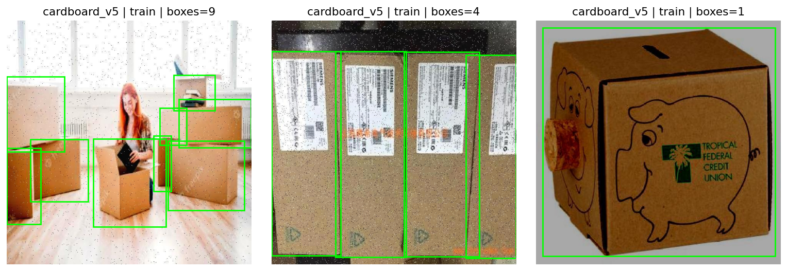
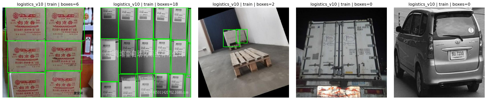
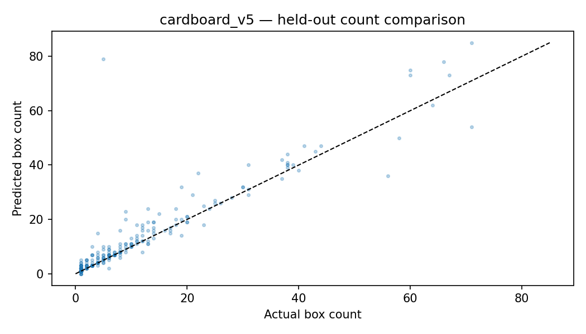
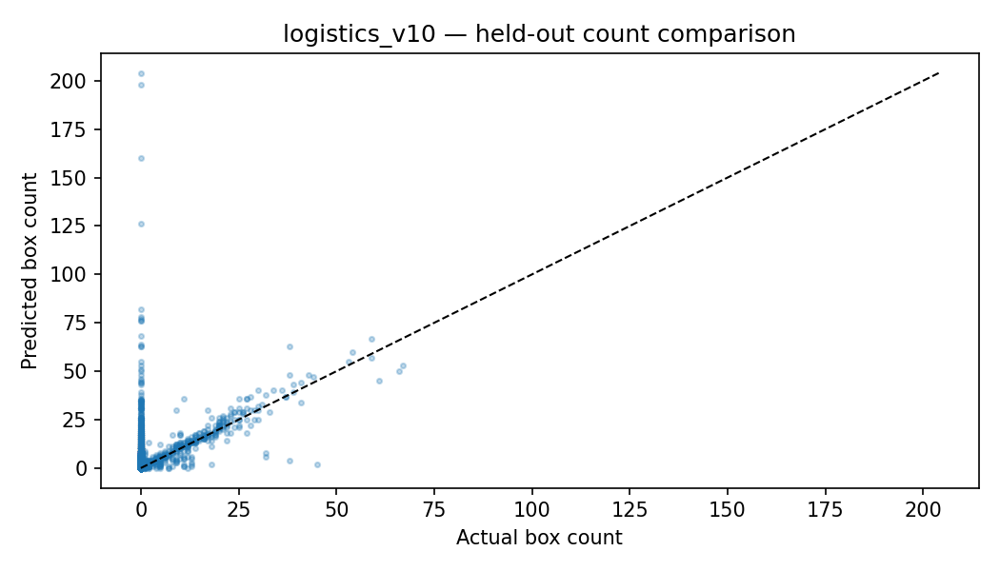
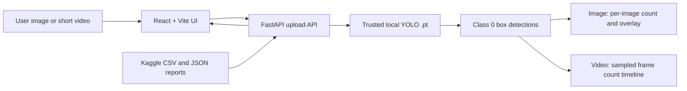

# BoxCount Vision

**Day 28 / 100 Days of Projects · Computer Vision · Manufacturing / Logistics · Research Prototype**

[English](README.md) · [Bahasa Indonesia](docs/id/README.md) · [Repository](https://github.com/MENSTRUE/BoxCount-Vision) · [Methodology](docs/en/methodology.md) · [Dataset & provenance](docs/en/datasets.md) · [Evaluation](docs/en/evaluation.md) · [API & architecture](docs/en/architecture.md) · [Troubleshooting](docs/en/troubleshooting.md)

> **Research-only scope.** Detect and count annotated cardboard boxes in *single images*; for video, produce **sampled per-frame counts**. This prototype does **not** measure unique packages passing a conveyor, perform ByteTrack, or provide warehouse-grade inventory verification. Performance values below come from saved Kaggle held-out reports, **not** from demo screenshots.

## 01 — Executive overview

Manual box counting can be slow and inconsistent in cluttered packaging or logistics scenes. BoxCount Vision connects a reproducible YOLO detector experiment to a locally running FastAPI + React research console. Its central question is **whether a detector trained on Cardboard v5 can count boxes accurately and generalize to a different, mostly-negative Logistics v10 domain**. The result is deliberately nuanced: detection is promising in-domain, while exact-count accuracy and external-domain recall remain limited.

**Problem:** crowded/occluded boxes, visual domain shift, uncertain annotations, false positives on empty scenes. **Task:** single-class (`class_id=0`, `box`) object detection, then per-image counting using `len(detections)`. **Deliverables:** original Kaggle notebook, selection/audit reports, model artifact outside Git, image/video research API, local dashboard, reproducibility and limitations.

## 02 — Before → Now → Next

| Stage | Evidence and current interpretation |
|---|---|
| **Before** | Combined source-specific Cardboard v5 and Logistics v10 inputs; cleaned image/label pairs; filename normalization; Kaggle notebook prepared and executed. |
| **Now** | 108,599 image–label pairs; dataset structural checks; exact SHA-256 cross-split check; YOLOv8n Experiment A completed (15 epochs); validation-selected best weights; full test evaluation for two domains; FastAPI and React demo pages. |
| **Next** | Confirm original source licenses and split provenance; exhaustively audit near-duplicates/annotation completeness; validate local `.pt` inference and frontend build on target Windows device; calibrate confidence on validation; optional Experiment B with domain-mixed training; document external-video outcomes. |

**Maturity:** reproducible *research evidence* + locally implemented demo, **not** industrial deployment validation.

## 03 — Evidence at a glance

| Measure | Cardboard v5 held-out | Logistics v10 held-out |
|---|---:|---:|
| Test images | 274 | 9,936 |
| Precision | 0.8805 | 0.7928 |
| Recall | 0.8464 | 0.6140 |
| mAP@50 | 0.9067 | 0.6777 |
| **mAP@50:95** | **0.7304** | **0.5909** |
| Count MAE (boxes/image) | 2.1241 | 2.4100 |
| Count RMSE (boxes/image) | 5.7826 | 5.9817 |
| **Exact-count accuracy** | **43.80%** | **14.68%** |

Source of truth: [`final_heldout_detection_metrics.csv`](reports/evaluation/final_heldout_detection_metrics.csv), [`heldout_count_metrics.csv`](reports/evaluation/heldout_count_metrics.csv), [`research_report.json`](reports/experiments/research_report.json). **Do not call mAP an exact-count accuracy.** Cross-domain scores should not be pooled without a stated distribution/weighting policy.

### Validation-only model choice

Experiment **A**, YOLOv8n pretrained initialization trained on a bounded **Cardboard v5 sample** (5,000 train; 539 validation); **15/15 epochs** completed. Candidate A: validation **mAP@50:95 = 0.7611466**, mAP@50 = 0.9089101. It is the *only executed candidate in this saved run*. Experiment B mixed-domain was configured but `RUN_EXPERIMENT_B=False`. Therefore the word **champion means best saved weights of this single-candidate selection**, not victory in a completed two-model comparison. Full test evaluation was performed after selection. Counting uses declared `conf=0.25` (not tuned on test).

## 04 — Sources, roles, and dataset inventory

| Dataset | Role | Train / valid / test images | Known limitations |
|---|---|---|---|
| **Cardboard v5** | Primary in-domain single-class detector training and test | 8,403 / 539 / 274 | Positive-only in this inventory; dense boxes and duplicate annotations observed by Ultralytics. |
| **Logistics v10** | External, source-separated generalization and counting test | 69,616 / 19,831 / 9,936 | Mostly negative-labeled: 9,487/9,936 test images have zero annotated boxes; missing annotations remain possible. |

**Total:** 108,599 images paired with labels after local exact duplicate cleaning. Detailed inventory: [`dataset_inventory.csv`](reports/audit/dataset_inventory.csv). Kaggle mounted data: `/kaggle/input/datasets/wafabila/boxcount-vision-dataset`. Original source URLs, licenses, versions, access dates and redistribution permissions must be confirmed **before claiming fully verified source provenance or mirroring the images**. See [dataset provenance register](docs/en/datasets.md). Do **not** infer a license from the absence of an explicit license file.

### Data split and leakage policy

The notebook **preserves source train/valid/test partitions**; it does not randomly re-split every frame. Structural image/label audit reported **0 invalid pairs**; an exact SHA-256 check reported **0 cross-split hash groups** on mounted input. This does **not** prove no near-duplicate, video/frame, source-camera, or derived-augmentation leakage. A *sampled* perceptual-hash check found **0 candidates in that sample** only. `filename_audit.json` in this repository retains the intermediate status `PASS_FILENAME_REWRITE_PENDING_CRC`; subsequent local ZIP/CRC confirmation was performed in a separate packaging workflow. Do not silently rewrite this historical status. Inspect [audit documentation](docs/en/datasets.md) and underlying records.

## 05 — Scientific workflow

1. Inventory both original source domains and inspect class mapping `0 = box`.
2. Check image–label pairing, image integrity, finite normalized YOLO box coordinates, negative samples, and split assignments.
3. Run exact SHA-256 across source splits; use sampled dHash only as a screening tool, not proof of independence.
4. Select *train/validation* subsets deterministically with seed 42. Save selection CSVs. **Do not subsample the held-out test set.**
5. Initialize YOLOv8n; train Experiment A for 15 epochs with `imgsz=640`, `batch=16`, and the saved Ultralytics run settings.
6. Choose saved weights using **validation mAP@50:95**; in this run only A was trained.
7. Evaluate the frozen selection on the full Cardboard and Logistics test splits separately; report detection *and* counting metrics.
8. Export source-aware reports, plots, the trusted `.pt` artifact and the research ZIP. Keep observed metrics immutable.

More detail: [methodology](docs/en/methodology.md), [evaluation](docs/en/evaluation.md).

## 06 — Visual evidence (real repository assets)

**Cardboard v5 training annotation examples**



**Logistics v10 annotated examples**



**Cardboard held-out actual vs predicted counts**



**Logistics held-out actual vs predicted counts**



The following UI captures require optional additional images under `assets/screenshots/`; **none are committed at the time of the repository audit**. API-generated previews under `backend/outputs/` are local execution artifacts and are not representative scientific validation imagery.

## 07 — System architecture and inference semantics



**Backend:** FastAPI; Ultralytics YOLO; OpenCV decoding, bounding-box overlay; read-only saved experiment reports; session-memory history and temporary preview JPEGs. **Frontend:** React 18, TypeScript, Vite, Recharts and Lucide; Overview, Image Detection, Video Analysis and Research/Audit. API status and model presence do not guarantee successful model inference. Video samples frames at configured FPS; **no persistent identities, no unique throughput**.

### Actual backend routes

| Method and route | Contract |
|---|---|
| `GET /api/v1/health` | API health and model file presence; not a full inference check |
| `GET /api/v1/experiments` | Existing Kaggle reports; missing reports yield empty fields |
| `GET /api/v1/history` | Recent results in RAM; lost on restart |
| `POST /api/v1/analyze/image` | Multipart image; detections, count, annotated JPEG URL |
| `POST /api/v1/analyze/video` | Multipart video; sampled per-frame count timeline |
| `GET /api/v1/files/{filename}` | Saved annotated preview JPEG |

See [API & architecture](docs/en/architecture.md). **Do not load model weights supplied by users** or execute files from uploaded media.

## 08 — Repository structure

```text
BoxCount Vision/
├── README.md                     # English source-of-truth overview
├── AGENTS.md                     # AI/developer evidence and safety rules
├── LICENSE                       # MIT software license
├── .gitignore                    # excludes local weights/raw datasets
├── .env.example
├── notebooks/
│   └── boxcount-vision.ipynb
├── models/
│   ├── baseline/                 # optional local artifacts (ignored by git)
│   └── champion/                 # expected local model destination
├── reports/
│   ├── audit/                    # inventory, hash, filename, label audits
│   ├── evaluation/               # test detection/count CSVs
│   ├── experiments/              # selections, candidate, research report
│   └── forecasts/                # reserved; not time-series forecasting
├── assets/
│   ├── examples/                 # real dataset annotation galleries
│   ├── plots/                    # count-scatter analyses
│   ├── screenshots/              # currently no committed app screenshots
│   └── diagrams/
├── backend/                      # FastAPI app, requirements, tests, outputs
├── frontend/                     # React/Vite client, package-lock.json
├── docs/en/                      # research/engineering references
├── docs/id/                      # Indonesian guide and reference
├── scripts/                      # reserved utility directory
└── tests/                        # reserved root-level tests
```

**Artifact policy:** `.pt` model weights and source dataset ZIPs are intentionally Git-ignored. The notebook and small CSV/JSON/PNG evidence files are tracked. Do not force-add raw video, massive image datasets, secrets, or run caches. `models/champion/boxcount_champion.pt` is the preferred local inference location; a documented fallback in current backend checks `models/baseline/boxcount_champion.pt`.

## 09 — Local reproducibility (Windows PowerShell)

**Prerequisites:** Python 3.11, working pip, Node.js/npm, adequate RAM/disk. To reproduce *research metrics*, separately run the saved Kaggle notebook with the attached source dataset, Ultralytics/PyTorch versions and GPU environment; **a local UI launch does not reproduce training**.

### Backend

```powershell
cd "D:\porto\100 day\day 28\BoxCount Vision\backend"
py -3.11 -m venv .venv
.\.venv\Scripts\Activate.ps1
python -m pip install -r requirements.txt
Copy-Item .env.example .env  # only if not already present
python -m pytest -q
python -m uvicorn app.main:app --reload --host 127.0.0.1 --port 8000
```

Visit `http://127.0.0.1:8000/docs`. Put only the **trusted Kaggle-exported** weights at `models/champion/boxcount_champion.pt` or set `BOXCOUNT_MODEL_PATH` in `backend/.env`. The model must be present for inference. Inference on CPU may be slower; GPU settings require a compatible PyTorch install.

### Frontend

```powershell
cd "D:\porto\100 day\day 28\BoxCount Vision\frontend"
Copy-Item .env.example .env  # only if not already present
npm ci
npm run build
npm run dev
```

Visit `http://127.0.0.1:5173`. The frontend calls the backend address defined in `.env.example`. Detailed setup: [deployment](docs/en/deployment.md).

## 10 — Testing and validation matrix

| Check | Current evidence | Interpretation |
|---|---|---|
| Notebook dataset structure & bbox checks | `invalid_annotation_audit.csv` empty | Structural audit passes; semantic annotation quality unverified |
| Exact cross-split SHA | `sha_leakage_audit.json`: 0 groups | Exact hashes only |
| Training & candidate selection | `research_report.json`, `validation_model_selection.csv` | Experiment A trained; B not trained |
| Full held-out evaluation | Two detection rows, two count rows | Research results, domain-specific |
| Backend API tests | `backend/tests/test_api.py` exists; 6/6 reported during development | Re-run locally; not proof that model predicts correctly |
| React build | Build config exists | Local build should be checked; not independently verified here |
| End-to-end real `.pt` inference | Application screenshot / reports are not a complete regression test | Test on actual representative files and record outputs |
| Deployment/security | No production audit | **Not production ready** |

Suggested smoke checks: `GET /api/v1/health`, `GET /api/v1/experiments`, valid image upload, rejected invalid file types/oversize, short MP4 frame-count response, API restart clearing memory history, mobile layout, offline API error handling. Use [testing guide](docs/en/testing.md).

## 11 — Claim boundaries and limitations

**Supported:** a YOLOv8n-based single-class detector trained in a Kaggle notebook; source-preserved held-out detection metrics; image-count regression via detected bounding boxes; per-frame short-video counts; a local FastAPI/React interface. **Not supported:** 90% counting accuracy; warehouse inventory-grade quality; unique boxes per video; conveyor throughput; verified near-duplicate-free datasets; flawless human-review labeling; safety monitoring; confidence intervals; unseen-site generalization guarantees; operational production deployment; **Experiment B has been completed**. Validation-only model selection was implemented, but only a single candidate executed.

Risks include heavy occlusion, missed and duplicate boxes, negative-only Logistics samples with incomplete annotation potential, preprocessing/augmentation similarity, threshold sensitivity, camera position, motion blur, lighting, model/source licensing, and unsupported codecs. Public video/photo assets used for ad hoc demonstrations are **not** held-out evaluation ground truth.

## 12 — Deployment and security posture

Local demo first. `.env` files and model weights remain local. Review/upload size limits, video duration/frame ceilings, decode failures, thread-safety and CPU cost. Before external access: auth, TLS, request throttling, quotas, sanitization, user data retention/deletion, CORS allowlisting, malicious-file defenses, safe model provenance, metrics/monitoring and automated builds. Avoid calling the current API 'production secured'. See [deployment document](docs/en/deployment.md).

## 13 — Roadmap

- [x] Two-domain dataset inventory and bounding-box structural audit
- [x] Exact SHA-256 cross-split duplicate check
- [x] YOLOv8n Experiment A, 15 epochs, validation-based saved best weights
- [x] Held-out detection and counting evaluations on **both** domains
- [x] FastAPI + React MVP and read-only research dashboard implementation
- [ ] Verify source licenses, versions, original split/video/camera provenance
- [ ] Exhaustive near-duplicate/source-level leakage and label completeness review
- [ ] Use validation data to choose counting confidence; freeze before new hold-out study
- [ ] Run **Experiment B** mixed-domain and compare on a common validation distribution
- [ ] Add qualitative failure taxonomy and negative-sample review
- [ ] Validate full-stack `.pt` inference end-to-end and automated frontend build
- [ ] Add authorized, privacy-aware security and deployment testing
- [ ] Consider tracking/line-crossing *as a separate future task*, with ID ground truth

## 14 — FAQ and troubleshooting

**Why does the dashboard show different numbers than a single image?** Saved metrics are historical **test-set aggregates**. A newly uploaded image is a new inference, not a benchmark.

**Why can mAP@50 look high while exact-count accuracy is low?** Detection scores use matching and confidence conventions, while exact-count requires every box in an image to be correct. One missed or extra detection makes the entire image incorrect.

**Does Video Analysis count unique boxes passing a conveyor?** No: sampled detection counts per frame only. It does not track identities and the same physical box may be counted in several frames.

**Why can Logistics look worse than Cardboard?** Different scene characteristics, class frequency, and uncertain annotation completeness; do not interpret this as a measured causal explanation.

**Why is the model not in GitHub?** Weight files are excluded by `.gitignore`; place your *trusted* `boxcount_champion.pt` locally under `models/champion/`.

**Why is there a model error despite green API status?** Health checks presence and connectivity, not a real YOLO forward pass. Check API logs, model path and PyTorch/Ultralytics compatibility.

**Why are some images incorrectly counted?** Occlusion, duplicates, missing labels, model domain shift, and conf/IoU decision thresholds can affect counts. Retain inputs, predictions and annotations when evaluating.

**Can this run on a warehouse camera?** Not as a validated operational tool. Camera integration, persistent tracking, security, uptime and field validation are future work.

Full incident matrix: [troubleshooting](docs/en/troubleshooting.md).

## 15 — License, attribution and provenance

The project's **original source code and documentation** are under the [MIT License](LICENSE), copyright © 2026 Wafa Bila Syaefurokhman. **That MIT license does not transfer ownership of third-party datasets, videos, model initialization weights or upstream annotations.** Review each original source's terms and the Ultralytics license obligations independently before redistribution or commercial use. Cite original dataset authors and record actual download/access dates. Keep Kaggle export manifests, software versions, random seed, training settings and split inventories with releases. See [datasets](docs/en/datasets.md).

## 16 — Author and reference

**Wafa Bila Syaefurokhman** · [GitHub @MENSTRUE](https://github.com/MENSTRUE) · [LinkedIn](https://www.linkedin.com/in/wafa-bila-syaefurokhman/)

**Day 28 of 100 — BoxCount Vision.** A useful result is not the largest detector score, but a transparent comparison between detection, reliable per-image counting, and cross-domain failure modes.
