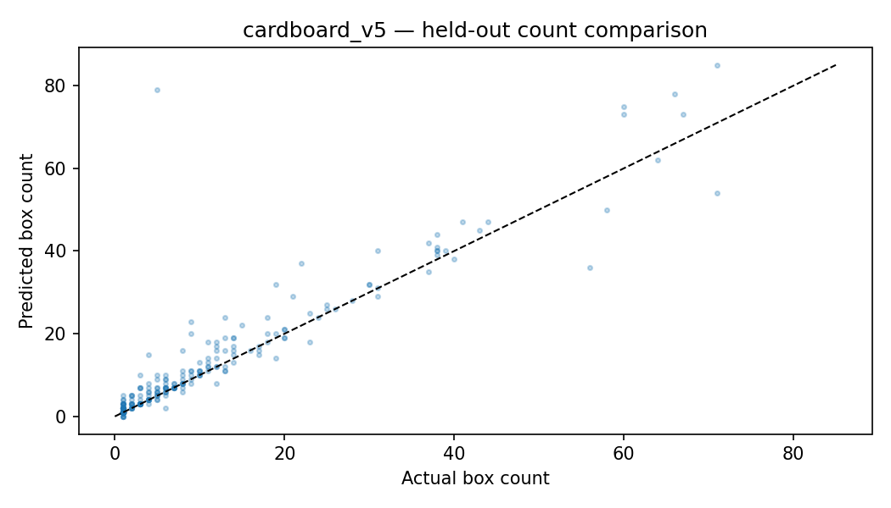
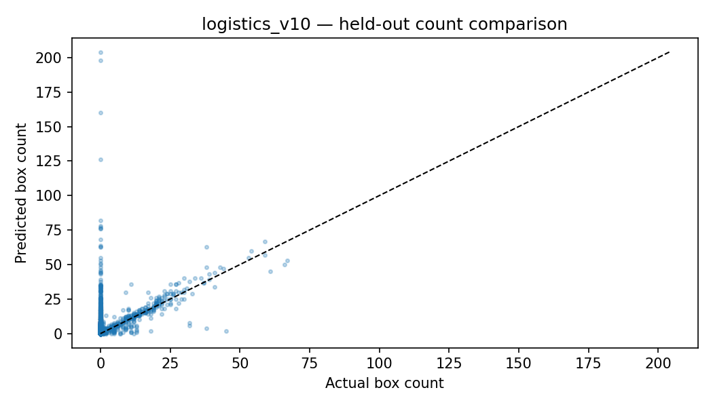

# Evaluation and evidence

## Test split — actual exported metrics
| Measure | Cardboard v5 (274) | Logistics v10 (9,936) |
|---|---:|---:|
| Precision | 0.880496 | 0.792790 |
| Recall | 0.846445 | 0.614032 |
| mAP@50 | 0.906729 | 0.677699 |
| mAP@50:95 | **0.730373** | **0.590912** |
| Count MAE | **2.124088** | **2.410024** |
| Count RMSE | 5.782556 | 5.981688 |
| Exact-count accuracy | **43.7956%** | **14.6840%** |

**Source:** `reports/evaluation/final_heldout_detection_metrics.csv`, `reports/evaluation/heldout_count_metrics.csv`. Count MAE means average absolute difference in number of boxes per image, not a percent. Exact-count accuracy means `predicted_count == annotated_count` at confidence 0.25.

## Research interpretation
The in-domain detector's mAP is stronger than external Logistics, but high mAP alone does not imply exact inventory counts. Logistic negatives dominate; if the 'zero box' annotation is incomplete, apparent false positives and counting errors may not reflect solely model quality. Large counting RMSE relative to MAE indicates material errors on some images. No confidence intervals or deployment-site benchmarks have been reported. An imbalanced 0-positive/positive distribution must be communicated with each score.

## Selection contract
Experiment A validation mAP@50:95 = 0.761146593. Experiment B selection files exist for a possible controlled mixed-domain run but **no B result**. Do not compare A against an imaginary B. Keep test hidden until champion selection; never optimize confidence from these held-out CSVs.

## Plots

