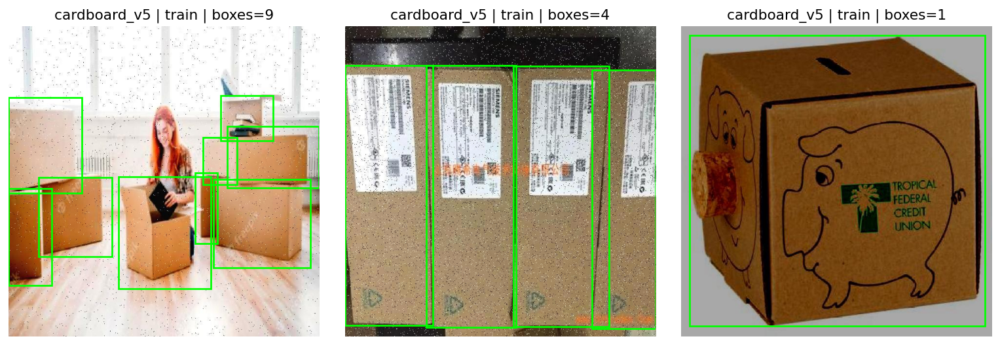
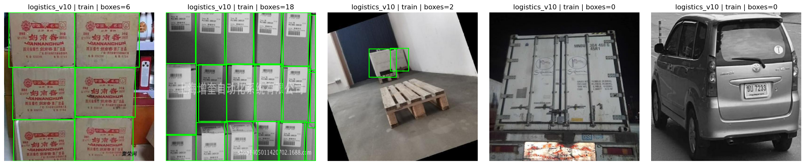
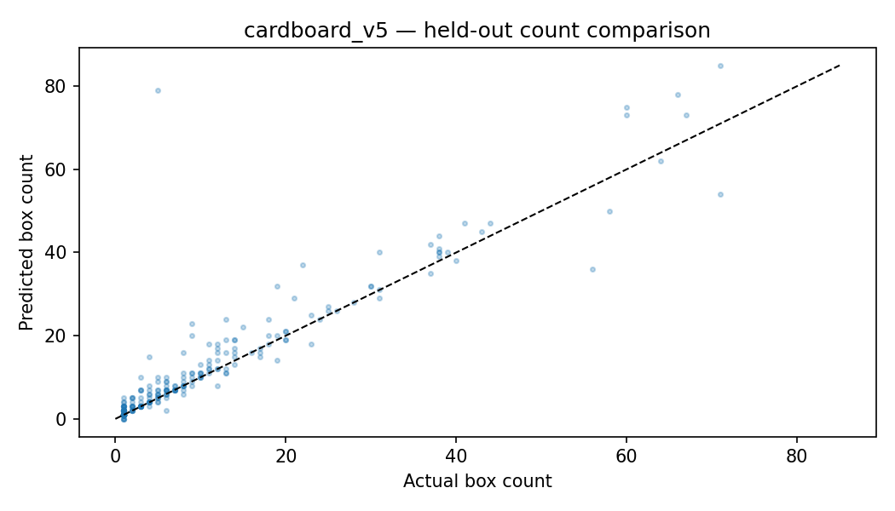
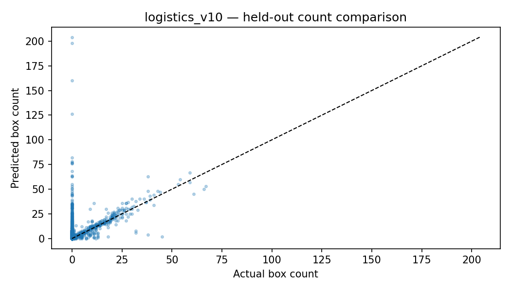

# BoxCount Vision — Dokumentasi Bahasa Indonesia

**Day 28/100 · Computer Vision · Deteksi dan Penghitungan Kardus · Prototipe Penelitian**

[README English](../../README.md) · [Repository GitHub](https://github.com/MENSTRUE/BoxCount-Vision) · [Metodologi](../en/methodology.md) · [Audit data](../en/datasets.md) · [API](../en/architecture.md)

> **Batas penelitian:** mendeteksi kardus dan menghitung jumlah deteksi dalam satu gambar. Video menghasilkan hitungan **per frame yang disampel**, **bukan** jumlah kardus unik yang melewati conveyor. Metrik berasal dari laporan held-out Kaggle, bukan screenshot demo.

## 01 — Ringkasan proyek dan masalah

BoxCount Vision menggabungkan model deteksi objek YOLOv8n, backend FastAPI, dan frontend React untuk menyelidiki apakah model yang dipelajari dari gambar Cardboard v5 dapat mendeteksi serta menghitung kardus, termasuk pada domain lain yaitu Logistics v10. Masalahnya: kardus bertumpuk, oklusi, perbedaan kamera, banyak gambar negatif, dan kemungkinan anotasi yang kurang lengkap. **Counting** = jumlah deteksi kelas 0 yang lolos ambang confidence, bukan estimasi stok atau throughput pabrik.

## 02 — Before → Now → Next

| Fase | Hasil dan batasannya |
|---|---|
| Before | Menyiapkan dan membersihkan sumber Cardboard v5 + Logistics v10; audit pasangan gambar/label dan penamaan arsip Kaggle. |
| Now | 108.599 pasangan gambar/label, audit struktural, pengecekan exact SHA, eksperimen A YOLOv8n 15 epoch, pemilihan best pada validasi, dua evaluasi held-out, API FastAPI, UI React. |
| Next | Verifikasi lisensi dan asal split, audit near-duplicate dan label, uji inferensi `.pt` lokal, build frontend, kalibrasi validasi, opsi eksperimen B, hardening security. |

## 03 — Dataset dan provenance

| Dataset | Train / Valid / Test | Peran |
|---|---|---|
| Cardboard v5 | 8.403 / 539 / 274 gambar | Domain utama untuk pelatihan dan evaluasi. Seluruh gambar pada inventaris berlabel positif. |
| Logistics v10 | 69.616 / 19.831 / 9.936 gambar | Domain eksternal pengujian; banyak label negatif (9.487 dari 9.936 gambar test). |

Total 108.599 pasangan. Mount Kaggle: `/kaggle/input/datasets/wafabila/boxcount-vision-dataset`. **URL sumber asli, hak cipta/lisensi, versi dan tanggal akses dataset belum seluruhnya dapat diverifikasi dari repo.** Jangan mengarang URL upstream atau menganggap lisensi MIT kode berlaku untuk dataset pihak ketiga. Audit sumber: `reports/audit/dataset_inventory.csv`.

## 04 — Audit dan kebocoran data

Notebook melaporkan **0 pasangan anotasi tidak valid**, **0 grup hash SHA-256 identik lintas split**, serta **0 kandidat near-duplicate pada sampel dHash**. Nilai terakhir **hanya hasil sampel**, bukan bukti bahwa seluruh gambar atau frame independen. Splits asli dipertahankan, bukan diacak ulang. Video/source-level, turunan augmentation, anotasi yang hilang, dan label box duplikat masih perlu diaudit. Berkas `filename_audit.json` menyimpan status intermediate dan tidak boleh diubah diam-diam menjadi status akhir; pengujian CRC packaging dilakukan terpisah.

## 05 — Metode, eksperimen dan logika champion

YOLOv8n pretrained, image size 640, batch 16, seed 42. **Eksperimen A**: 5.000 gambar train Cardboard, 539 validasi, selesai 15 epoch. Model dipilih berdasarkan **validation mAP@50:95 = 0,76114659**. Hanya **satu kandidat dilatih** pada run ini; eksperimen B mixed-domain **belum dijalankan**, meskipun CSV pemilihan subset telah dibuat. Test diukur setelah model dipilih dan tidak boleh dipakai untuk tuning. Nilai counting dihitung pada `confidence=0.25`.

## 06 — Hasil held-out sebenarnya

| Metrik | Cardboard v5 | Logistics v10 |
|---|---:|---:|
| Test images | 274 | 9.936 |
| Precision | 88,05% | 79,28% |
| Recall | 84,64% | 61,40% |
| mAP@50 | 90,67% | 67,77% |
| **mAP@50:95** | **73,04%** | **59,09%** |
| Count MAE (kardus/gambar) | 2,124 | 2,410 |
| Count RMSE | 5,783 | 5,982 |
| **Exact-count accuracy** | **43,80%** | **14,68%** |

**Inti temuan:** performa deteksi tidak sama dengan akurasi penghitungan kardus persis. Ada gap besar pada Logistics, dan banyak gambar tanpa anotasi yang bisa membuat interpretasi metrik lebih sulit. Sumber data angka: `reports/evaluation/final_heldout_detection_metrics.csv`, `reports/evaluation/heldout_count_metrics.csv`, `reports/experiments/research_report.json`. **Jangan klaim 90,67% sebagai akurasi counting.**

## 07 — Galeri aset penelitian






Aset screenshot aplikasi belum tersedia sebagai file committed ketika repo diaudit; jangan menyematkan path fiktif. Gambar preview yang dihasilkan API adalah hasil demo, bukan bukti angka benchmark.

## 08 — Arsitektur dan fitur aplikasi

Frontend React + TypeScript + Vite → FastAPI → bobot YOLO `.pt` lokal → bounding box kelas 0 → hitungan satu gambar atau grafik jumlah per frame video. FastAPI membaca metrik penelitian dari CSV/JSON lokal. Halaman UI: Overview, Image Detection, Video Analysis, Research & Audit. **Belum ada ByteTrack, persistent ID, line-crossing atau unique throughput.** History disimpan sementara di RAM, hilang setelah restart.

| Endpoint | Fungsi |
|---|---|
| `GET /api/v1/health` | Status API dan keberadaan model, belum menguji forward-pass |
| `GET /api/v1/experiments` | Laporan Kaggle yang tersimpan |
| `GET /api/v1/history` | Hasil inferensi sementara |
| `POST /api/v1/analyze/image` | Upload dan hitung deteksi gambar |
| `POST /api/v1/analyze/video` | Video, jumlah deteksi per frame sampel |
| `GET /api/v1/files/{filename}` | Preview JPEG anotasi |

## 09 — Struktur repository

`README.md`, `AGENTS.md`, `LICENSE`, `.gitignore`, `.env.example`, `notebooks/boxcount-vision.ipynb`, `models/{baseline,champion}/`, `reports/{audit,evaluation,experiments,forecasts}/`, `assets/{examples,plots,screenshots,diagrams}/`, `backend/`, `frontend/`, `docs/{en,id}/`, `scripts/`, `tests/`. Jangan buat folder `datasets/` baru. Bobot `.pt` dan dataset mentah dikecualikan Git; laporan kecil, notebook dan bukti plot boleh disimpan.

## 10 — Menjalankan secara lokal

**Backend (PowerShell):**

```powershell
cd "D:\porto\100 day\day 28\BoxCount Vision\backend"
py -3.11 -m venv .venv
.\.venv\Scripts\Activate.ps1
python -m pip install -r requirements.txt
Copy-Item .env.example .env
python -m pytest -q
python -m uvicorn app.main:app --reload --host 127.0.0.1 --port 8000
```

Taruh model Kaggle terpercaya di `models/champion/boxcount_champion.pt`, jangan upload model asal internet. Swagger `http://127.0.0.1:8000/docs`.

**Frontend (PowerShell terminal lain):**

```powershell
cd "D:\porto\100 day\day 28\BoxCount Vision\frontend"
Copy-Item .env.example .env
npm ci
npm run build
npm run dev
```

UI `http://127.0.0.1:5173`.

## 11 — Reproducibility dan testing

Untuk mereproduksi **hasil riset**, jalankan notebook Kaggle dengan dataset terpasang, seed 42 dan konfigurasi asli. Menjalankan backend/frontend saja **tidak** mereproduksi training. Pengujian API `python -m pytest -q`; frontend `npm run build`; smoke test API status, eksperimen, upload gambar valid/rusak, video pendek, dan error CORS. Laporan pengembangan awal menyebut 6/6 tes backend lulus, tetapi status build frontend dan inferensi nyata model di Windows masih perlu diverifikasi sendiri. Jangan menampilkan badge otomatis PASS sebelum dieksekusi.

## 12 — Batas klaim dan keterbatasan

**Boleh diklaim:** YOLOv8n untuk deteksi kardus satu kelas, dua evaluasi held-out, penghitung deteksi per gambar, monitoring jumlah per frame sampel, dashboard penelitian lokal. **Tidak boleh diklaim:** sistem inventory industri siap pakai, akurasi counting 90%, jumlah kardus unik lewat conveyor, tracking ber-ID, bebas near-duplicate sepenuhnya, eksperimen B telah dilatih, lisensi semua data sudah aman, atau deployment production-ready. Risiko: oklusi, label kurang lengkap, image/video blur, negative-label imbalance, domain shift, ambang confidence, dan kapasitas mesin.

## 13 — Keamanan dan deployment

Prototipe dijalankan lokal; `.env` dan bobot model jangan dipush. Sebelum publish server: auth, TLS, pembatasan upload, kuota/limiter, inspeksi media, kontrol CORS, privasi/retensi file, monitoring, versioning model, antrian tugas video dan validasi latency per device. Kondisi itu **belum tervalidasi untuk produksi**.

## 14 — Roadmap

- [x] Inventaris dataset + validasi struktural
- [x] Pemeriksaan SHA-256 exact lintas split
- [x] Eksperimen A selesai, bobot best dan metrik validasi
- [x] Evaluasi test dua domain + metrik counting
- [x] Implementasi MVP FastAPI + React
- [ ] Verifikasi asal dataset, lisensi dan split tingkat video
- [ ] Audit near-duplicate yang menyeluruh dan cek label negatif
- [ ] Uji end-to-end `.pt` di Windows dan build UI
- [ ] Kalibrasi confidence menggunakan validasi saja
- [ ] Jalankan eksperimen B jika dibutuhkan
- [ ] Analisis kesalahan per kategori, studi kamera nyata
- [ ] Security/deployment testing

## 15 — FAQ dan troubleshooting

**Kenapa count berbeda dari label?** Model bisa melewatkan kardus, menduplikasi box, atau salah deteksi; confidence, posisi dan pencahayaan berpengaruh.

**Kenapa API connected tapi model tidak memprediksi?** Health check hanya memeriksa koneksi/keberadaan file. Periksa `models/champion/boxcount_champion.pt`, log dan versi Ultralytics/PyTorch.

**Kenapa video tidak menampilkan total kardus unik?** Belum ada ID tracking. Jumlah yang sama dapat muncul di beberapa frame.

**Kenapa skor mAP bagus tapi exact count rendah?** Perhitungan exact mensyaratkan semua objek pada setiap gambar benar, bukan hanya banyak bounding box yang cocok.

**Mengapa model tidak ikut GitHub?** File `.pt` besar dan tidak aman untuk dibagikan sembarang; dikecualikan `.gitignore`.

**Kenapa Logistics lebih sulit?** Domain berbeda, banyak gambar negatif, dan kelengkapan anotasi belum terverifikasi. Jangan membuat klaim sebab-akibat tanpa audit.

**Bagaimana kalau CORS/error upload?** Jalankan API di port 8000 dan UI 5173, periksa `.env`, ukuran dan codec, serta log backend. Petunjuk teknis tambahan di `docs/en/troubleshooting.md`.

## 16 — Lisensi, pengakuan dan pembelajaran

Kode dan dokumentasi asli repo: **MIT**, copyright 2026 Wafa Bila Syaefurokhman. Lisensi dataset, gambar, video, dan bobot pihak ketiga **harus dicek terpisah**. Pelajaran inti: **mAP tinggi belum membuktikan hitung kardus tepat; kualitas label, desain evaluasi dan generalisasi jauh lebih penting daripada angka demo.**

[GitHub](https://github.com/MENSTRUE/BoxCount-Vision) · [LinkedIn](https://www.linkedin.com/in/wafa-bila-syaefurokhman/)
